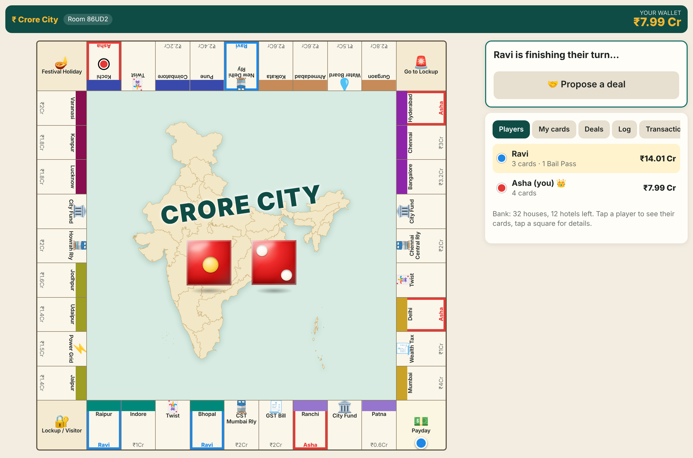
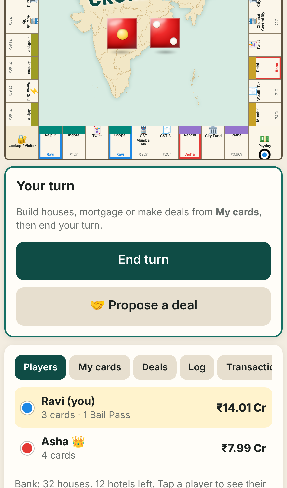
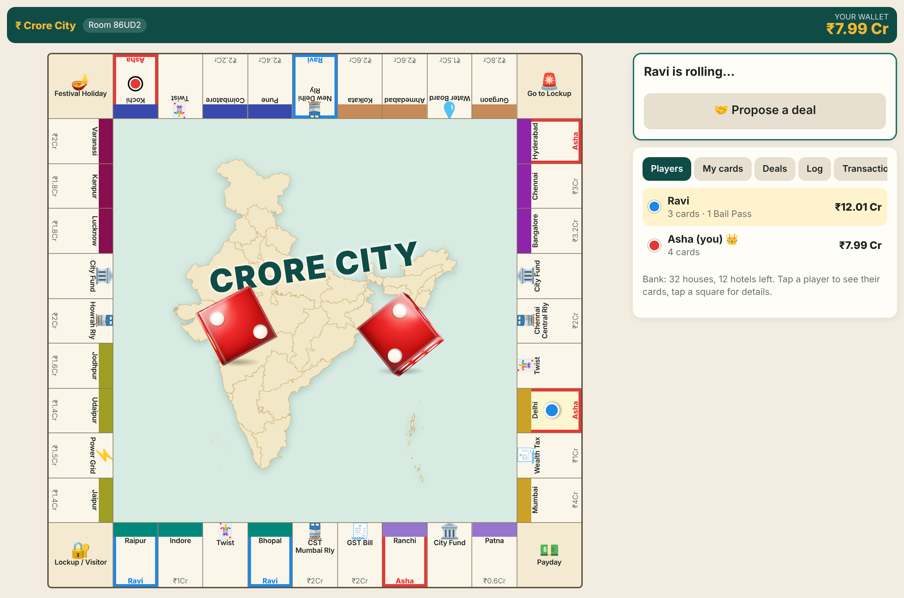
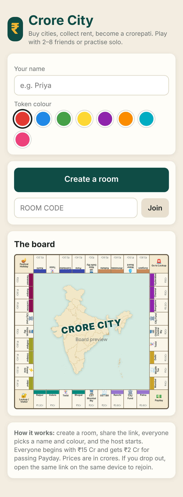
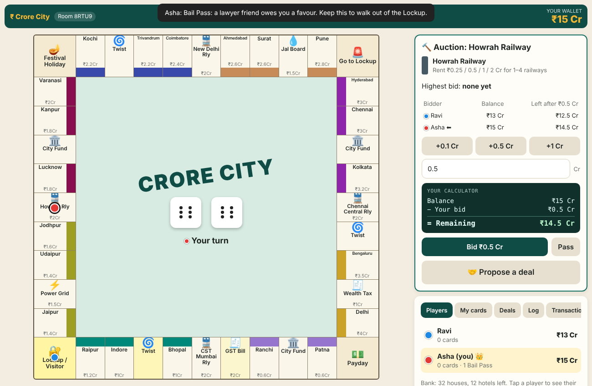
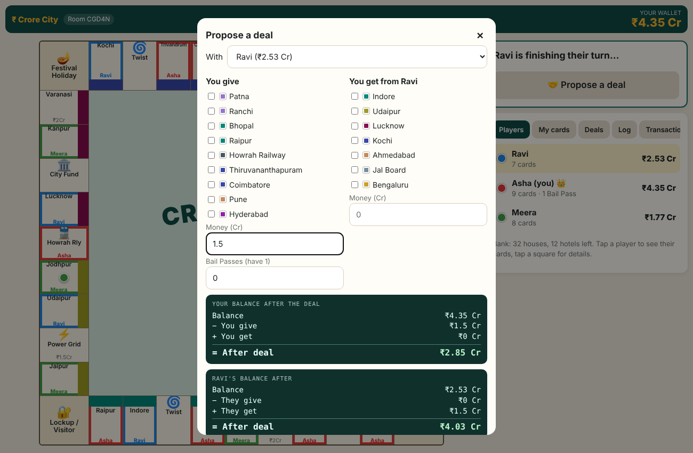

# Crore City

**A real-time multiplayer property-trading board game set in Indian cities, played in the browser on phones and laptops.**

Players create a room, share a link, and trade their way across a 40-square board of Indian cities, railways and utilities. All money is in crores (₹), with a built-in calculator that shows exactly what every purchase, bid, rent or deal does to your balance before you confirm it.

[](https://render.com/deploy?repo=https://github.com/Mahakksh2801/Business)

| Desktop | Phone |
|---|---|
|  |  |

| Dice rolling in the centre of the board | Board preview on the home screen |
|---|---|
|  |  |

| Auction with live calculator | Proposing a deal |
|---|---|
|  |  |

---

## How to play

1. Open the site, enter your name, pick a token colour and **Create a room**.
2. Share the room link (or the 5-letter code). Friends open it, pick a name and colour, and join.
3. The host presses **Start**. Turn order is decided by a dice roll.
4. Roll, move, buy or auction cities, collect rent, build ◆ houses and ★ hotels, and make deals. The last player who isn't bankrupt wins.

Everyone starts with **₹15 Cr** and collects **₹2 Cr** each time they pass **Payday**.

## Features

### Multiplayer
- Create/join rooms with a short code and a shareable link; 2–8 players
- See the full board from the home screen and lobby, or start a solo practice game on your own
- Real-time sync over WebSockets, so every device shows the same board instantly
- Server-authoritative game state: clients send actions, the server validates every rule
- Disconnect-proof: reopen the link on the same device, or type the same name on a new one, and you're back with your money and cards
- The host can skip an offline player's turn or auction bid so the game never stalls

### Money and the built-in calculator
- A wallet at the top of the screen always shows your live balance
- Landing on an unowned city opens a **Buy or Auction** prompt with `Balance − Price = Remaining`
- Auctions run in turn order with **+0.1 Cr / +0.5 Cr / +1 Cr** buttons or a custom bid, and a table showing each bidder's balance after the current bid
- Rent, taxes, houses, hotels, mortgages, unmortgaging and deals all update balances live
- A **transaction log** records who paid whom, how much and why

### Rules
- Dice with doubles (three doubles in a row sends you to the Lockup)
- The Lockup: roll doubles, pay ₹0.5 Cr bail, or use a Bail Pass; pay after three failed tries
- 8 colour sets (the top Metros set is Delhi and Mumbai), 4 railways, 2 utilities, GST Bill and Wealth Tax squares, Festival Holiday
- 32 original **Twist** and **City Fund** cards
- Full colour set doubles base rent; ◆ houses and ★ hotels with the even-build rule and a limited bank supply (32 / 12)
- **Mortgage** any property without buildings for half its price; **unmortgage** for that amount plus 10%. Mortgaged cities collect no rent and are hatched on the board
- Debts: if you can't pay, sell buildings, mortgage or trade to raise money, or declare bankruptcy (assets go to your creditor or back to the bank)

### Deals
- Any player can propose a deal to any other player at any time
- Swap cities for cities, several for several, cities for money, cities plus money on both sides, or money only (Bail Passes too)
- The other player gets a popup to **Accept**, **Reject** or **Counter**
- Nothing moves until it is accepted; the server re-checks that nobody offers more money than they hold, and both calculators show the balance after the deal

### UX
- Responsive layout: board and side panel on laptops, stacked layout on phones
- Owner colour outline on every owned square, houses and hotels drawn on the colour band
- Red 3D dice that tumble into the centre of the board on every roll, with the total and a doubles badge; tokens move once the dice land
- Pulsing token for the player whose turn it is, card pop-ups
- Tap any square for its full rent table; tap any player to see their cards

## Tech stack

| Layer | Choice |
|---|---|
| Server | Node.js, [`ws`](https://github.com/websockets/ws) WebSockets, built-in `http` for static files |
| Game logic | Pure JavaScript rules engine (`game.js`), no framework |
| Client | Vanilla HTML/CSS/JS, CSS grid board, container-query sizing for phones |
| Hosting | Render free web service (`render.yaml`) |
| Testing | Randomised rules fuzz test + Playwright multi-browser end-to-end tests |

## Project structure

```
├── server.js          # HTTP + WebSocket server, rooms, reconnects, persistence
├── game.js            # Rules engine: board, cards, money, auctions, deals, bankruptcy
├── public/
│   ├── index.html
│   ├── app.js         # Client UI: lobby, board, calculator, auctions, deals
│   └── style.css
├── test/
│   ├── fuzz.js        # Plays 300 random games and checks money/building invariants
│   ├── e2e.js         # 3 browsers (incl. iPhone) play, trade and reconnect
│   └── auction.js     # Browser test of the auction flow
├── docs/              # Screenshots
└── render.yaml        # One-click Render deployment
```

### How the realtime sync works

Each room lives on the server. A client sends a small action (`roll`, `buy`, `bid`, `propose`, ...) over its WebSocket; the server checks it against the rules in `game.js`, updates the room, and broadcasts the new public state to every device in that room. Clients never decide outcomes themselves, so all screens agree and nobody can cheat by editing their browser. Each player holds a private rejoin token in `localStorage`, which is how a refresh or dropped connection puts you straight back into your seat.

## Run it locally

```bash
npm install
npm start            # http://localhost:3000
npm test             # rules fuzz test (300 random games)
```

End-to-end tests (need Playwright installed):

```bash
npm start &
node test/e2e.js     # writes screenshots to the current folder
```

## Deploy

Click **Deploy to Render** above, or create a Render *Web Service* from this repo with build command `npm install` and start command `node server.js`. Any Node host with WebSocket support works; it listens on `PORT`.

On Render's free plan the server sleeps after about 15 minutes with no visitors, so the first load can take up to a minute, and rooms are cleared when it sleeps.

## Credits

An original game design: board layout, city sets, card text, names and visuals are all original. Built with help from Claude.

Map of India from [svg-maps](https://github.com/VictorCazanave/svg-maps) by Victor Cazanave, licensed [CC BY 4.0](https://creativecommons.org/licenses/by/4.0/) (colours changed).
